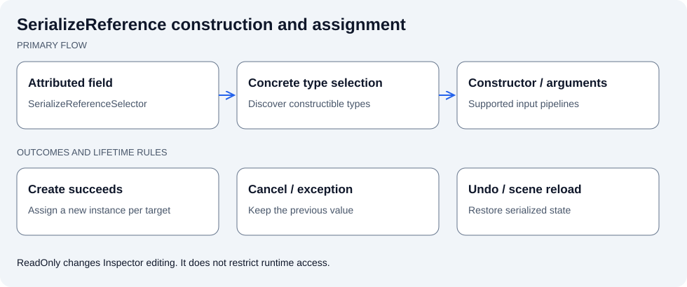

# Jeomseon Unity Attributes

한국어 | [English](README.en.md)

Inspector 표시·값 제한·참조 연결·메서드 실행·SerializeReference 생성을 Attribute로 구성합니다. 선언과 Editor 구현을 어셈블리로 분리합니다.



생성자 입력과 할당은 분리됩니다. 생성 성공 전에 기존 값을 바꾸지 않으며 다중 선택 대상마다 독립 인스턴스를 만듭니다.

## 빠르게 시작하기

필드/메서드에 Attribute 선언 → Inspector에서 편집 또는 실행 → SerializedProperty/Undo 경로로 반영. SerializeReference 생성자 인자는 별도 팝업에서 확인 후 적용합니다.

전체 샘플 코드: [AttributesSample.cs](Samples~/BasicUsage/AttributesSample.cs).

```csharp
using Jeomseon.Unity.Attributes;
using UnityEngine;
using UnityEngine.Serialization;

namespace Jeomseon.Samples.Attributes
{
    public sealed class AttributesSample : MonoBehaviour
    {
        [InfoBox("Attributes 패키지가 Attribute Drawer를 함께 제공합니다.")]
        [InspectorName("표시 이름")]
        [SerializeField, FormerlySerializedAs("_message")] private string message = "Hello";

        [ReadOnly]
        [SerializeField, FormerlySerializedAs("_changeCount")] private int changeCount;

        [Min(0f)]
        [SerializeField, FormerlySerializedAs("_minimumBoundedValue")] private float minimumBoundedValue;

        [MaxValue(10)]
        [SerializeField, FormerlySerializedAs("_maximumBoundedValue")] private int maximumBoundedValue;

        [InvokeOnInspectorChange(nameof(message))]
        private void OnMessageChanged()
        {
            changeCount++;
            Debug.Log($"값 변경 콜백: {message}");
        }

        [InspectorButton("메시지 출력")]
        private void PrintMessage()
        {
            Debug.Log(message);
        }
    }
}
```

## 계약과 주의사항

ReadOnly는 런타임 접근 제어가 아닙니다. 변경 콜백은 Undo 편집 스트림을 관찰합니다. 생성자의 모든 인자 타입에 입력 파이프라인이 있어야 합니다.

## 요구 사항

- Unity `6000.6.0f1`
- 패키지: `com.jeomseon.unity.attributes` `0.4.2`
- `com.jeomseon.unity.editor-toolkit`: `0.7.2`
- `com.jeomseon.unity.core`: `0.3.2`

## 설치

프로젝트 `Packages/manifest.json`의 기존 dependencies와 registry를 유지하면서 다음 항목을 병합합니다.

```json
{
  "scopedRegistries": [
    {
      "name": "OpenUPM",
      "url": "https://package.openupm.com",
      "scopes": [
        "com.jeomseon"
      ]
    }
  ],
  "dependencies": {
    "com.jeomseon.unity.attributes": "0.4.2"
  }
}
```

또는 Package Manager의 **Install package from git URL**을 사용합니다:

```text
https://github.com/jeomseon0516/Unity.Attributes.git#v0.4.2
```

## 설계와 동작

### 사용 범위

반복되는 Inspector 표시·오브젝트 연결·메서드 호출·다형성 값 생성을 Attribute 선언으로
구성합니다. 게임 도메인의 실행 로직은 포함하지 않습니다. Attribute 선언은 Runtime 어셈블리에,
Drawer와 타입 탐색·반사 호출·Undo 처리는 Editor 어셈블리에 둡니다.
Localization이나 Pooling 전용 Attribute는 해당 기능 패키지가 소유합니다.

| 작업 | API | 주의점 |
| --- | --- | --- |
| 안내·미리보기·읽기 전용 표시 | `InfoBox`, `SpritePreview`, `ReadOnly` | Inspector 표현이며 런타임 접근 제어가 아님 |
| 수치 입력 | `MaxValue`, `Vector2Slider` | 최소값 제한만 필요하면 Unity `Min` 사용 |
| 참조 연결 | `GetOrAddComponent`, `HierarchyObjectPicker` | 실제 Scene·Prefab 참조와 Undo 결과를 확인 |
| 버튼 실행 | `InspectorButton` | 편집 도구 동작과 런타임 초기화를 구분 |
| 편집 변경에 응답 | `InvokeOnInspectorChange` | Undo 변경 스트림 기반, 매개변수 없는 메서드 |
| 다형성 참조 생성 | `SerializeReferenceSelector` | Unity `[SerializeReference]`와 함께 사용 |

`ReadOnly`는 코드에서 값을 수정하는 것을 막지 않습니다. `InvokeOnInspectorChange`는
런타임 setter나 C# event를 대신하지 않습니다. Inspector Injection 설정과 Header fallback은
같은 버튼을 중복 표시하지 않도록 선택되는 경로입니다.

### 실제 예제

[AttributesSample.cs](Samples~/BasicUsage/AttributesSample.cs)는 `InfoBox`, `ReadOnly`,
`MaxValue`, `InspectorButton`, `InvokeOnInspectorChange`를 함께 보여줍니다.
사용 시 Attribute namespace는 `Jeomseon.Unity.Attributes`입니다.

```csharp
[InfoBox("10 이하의 값으로 편집합니다.")]
[MaxValue(10)]
[UnityEngine.SerializeField] private int count;

[InvokeOnInspectorChange(nameof(count))]
private void OnCountEdited() => UnityEngine.Debug.Log(count);
```

위 Attribute를 사용하는 소비 스크립트는 해당 namespace를 import해야 합니다. 완성된 실행·편집
예제는 [Basic Usage](Samples~/BasicUsage/README.md)의 Scene을 Import해 확인하세요.

### SerializeReference 생성 흐름

1. 직렬화 필드의 기준 타입을 해석하고 생성 가능한 구체 타입을 찾습니다.
2. 매개변수 없는 생성만 필요한 경우 값을 직접 생성합니다. 인자가 필요하면 생성자 팝업에서 선택합니다.
3. 지원되는 public 생성자마다 입력 UI와 기본 인자를 준비합니다.
4. 생성 성공 시 대상마다 새 인스턴스를 만들고 Undo 가능한 할당을 수행합니다.
5. 생성 실패 또는 취소 시 이전 값을 유지합니다. `(None)`은 명시적으로 null을 할당합니다.

입력 파이프라인은 `int`, `float`, `double`, `bool`, `string`, enum, Unity Object, Color,
Vector2/3/4를 지원합니다. 지원하지 않는 매개변수가 있는 생성자는 후보에 포함되지 않습니다.
Editor 전용 `ISerializeReferenceSelectorConstructorParameterPipeline` 구현을 TypeCache로 검색하므로
사용자 인자 타입의 입력기를 추가할 수 있습니다. 파이프라인 구현에는 public 매개변수 없는 생성자가
필요합니다. 지원 가능 여부와 기본값, 필드 그리기를 구현하며 선택적 이름 Attribute로 표시명을 지정합니다.

### 코드와 검증 경로

- [Attribute 선언](Runtime): 런타임/에디터 경계와 사용자 문법
- [Selector Drawer](Editor/SerializeReferenceSelectorDrawer.cs): 타입 선택과 팝업 연결
- [생성자 선택](Editor/ConstructorSelectionService.cs): 오버로드·기본값·예외
- [입력 파이프라인](Editor/ConstructorPipelines): 지원 타입과 확장 계약
- [테스트](Tests/Editor): 생성자, 다중 선택, 직렬화 복원과 Editor 구현 회귀

Scene 저장·재오픈, 다중 선택의 독립 인스턴스, 생성자 예외, 취소, Undo,
Assembly/Domain Reload에 따른 중복 버튼 여부를 [샘플 절차](Samples~/BasicUsage/README.md)로 확인합니다.

## API 사용과 상세 설명

### 포함 기능

- 표시·편집: `InfoBox`, `ReadOnly`, `SpritePreview`, `Vector2Slider`
- 값 제한: `MaxValue` (`Min`은 Unity 기본 API 사용)
- 오브젝트 연결: `GetOrAddComponent`, `HierarchyObjectPicker`
- 다형성 참조: `SerializeReferenceSelector` (`SerializeReference` 단일 필드·리스트의 구체 타입 선택)
- 메서드 실행: `InspectorButton`, `InvokeOnInspectorChange`
- 각 Attribute의 PropertyDrawer, Inspector UI 및 메서드 실행 구현

### Sample 검증

`Samples~/BasicUsage/AttributesSample.cs`는 `InfoBox`, `MaxValue`, `ReadOnly`의 선언 예제입니다.
실행 가능한 Scene은 `InspectorButtonSample`, `ObjectAssignmentSample`,
`SerializeReferenceSelectorSample`입니다. 각각 버튼·변경 알림, 참조 할당·Undo,
다형성 생성·저장·복원을 확인합니다. 상세 절차는 [샘플 안내](Samples~/BasicUsage/README.md)에 있습니다.

Injection 회귀 확인은 다음 순서로 진행합니다.

1. `Project Settings > Jeomseon > Attributes`에서 Injection을 활성화하고 InspectorButton이 하나만 표시되는지 확인합니다.
2. Injection을 비활성화하고 Inspector Header fallback 버튼이 하나만 표시되는지 확인합니다.
3. Assembly Reload와 Domain Reload를 각각 활성화/비활성화한 뒤 버튼 중복, 누수, 재활성화 실패가 없는지 확인합니다.

`InvokeOnInspectorChange`는 Inspector나 Editor 도구가 Undo를 통해 직렬화 필드를
변경했을 때 매개변수 없는 메서드를 지연 호출합니다. 런타임 값 변경 알림 용도가 아닙니다.

`SerializeReferenceSelector`는 `[SerializeReference]`와 함께 사용합니다. `(None)`을 선택하면
참조 또는 리스트 원소가 `null`이 됩니다. public 생성자의 모든 매개변수를 입력 파이프라인이
지원하는 구체 타입을 선택할 수 있습니다. 매개변수 생성자는 팝업에서 오버로드와 인자를 선택한 뒤
생성합니다. 취소하거나 생성자가 예외를 던지면 기존 필드 값을 유지합니다.

기본 지원 인자는 `int`, `float`, `double`, `bool`, `string`, enum, `UnityEngine.Object` 파생 타입,
`Color`, `Vector2`, `Vector3`, `Vector4`입니다. 사용자 타입은 Editor 어셈블리에서
`ISerializeReferenceSelectorConstructorParameterPipeline`을 구현해 확장합니다.

### 패키지 경계

- 이 패키지는 특정 기능 도메인에 의존하지 않는 Inspector Attribute의 선언과 Editor 구현을 소유합니다.
- 공통 Editor API는 `com.jeomseon.unity.editor-toolkit`을 단방향으로 참조해 재사용합니다.
- 기능 전용 Attribute는 해당 기능 패키지가 소유합니다. 예를 들어 `LocalizedStringAttribute`는
  `com.jeomseon.unity.localization`, `ResetOnPoolReleaseAttribute`는
  `com.jeomseon.unity.game-object-pooling`에서 제공합니다.
- Runtime asmdef는 Editor 어셈블리를 참조하지 않으며 Editor 의존성은 Editor asmdef에만 제한됩니다.

## 동작 확인

1. Basic Usage의 `SerializeReferenceSelectorSample.unity`를 열고 Selected Effect에서 StunAttributeEffect를 선택합니다.
2. 생성자 팝업에서 duration/description을 입력하고 생성합니다. 입력값이 할당되고 Scene 저장·재오픈 후 유지되는지 확인합니다.
3. 다른 타입을 선택한 뒤 취소해 이전 값을 유지하는지, Undo로 이전 상태에 돌아가는지 확인합니다.
4. 두 Sample 객체를 함께 선택해 생성한 뒤 한쪽 값만 변경합니다. 다른 대상의 값이 함께 변하지 않아야 합니다.

## 샘플 실행

**Package Manager > Samples**에서 예제를 Import합니다. 포함된 Scene 또는 Editor 도구를 열고 필요한 Setup 메뉴를 먼저 실행합니다.

- [Basic Usage](Samples~/BasicUsage/README.md)
  - [InspectorButtonSample](Samples~/BasicUsage/InspectorButtonSample.unity)
  - [ObjectAssignmentSample](Samples~/BasicUsage/ObjectAssignmentSample.unity)
  - [SerializeReferenceSelectorSample](Samples~/BasicUsage/SerializeReferenceSelectorSample.unity)

## 테스트

[테스트 코드](Tests)

manifest의 `testables`에 패키지 ID를 추가하고 Unity Test Runner의 관련 EditMode/PlayMode 어셈블리를 실행합니다.

## 추가 문서

[전체 코드 지도와 패키지 구성](Documentation~/Overview.md)
- [Changelog](CHANGELOG.md)

## 라이선스

[License](LICENSE.md)
